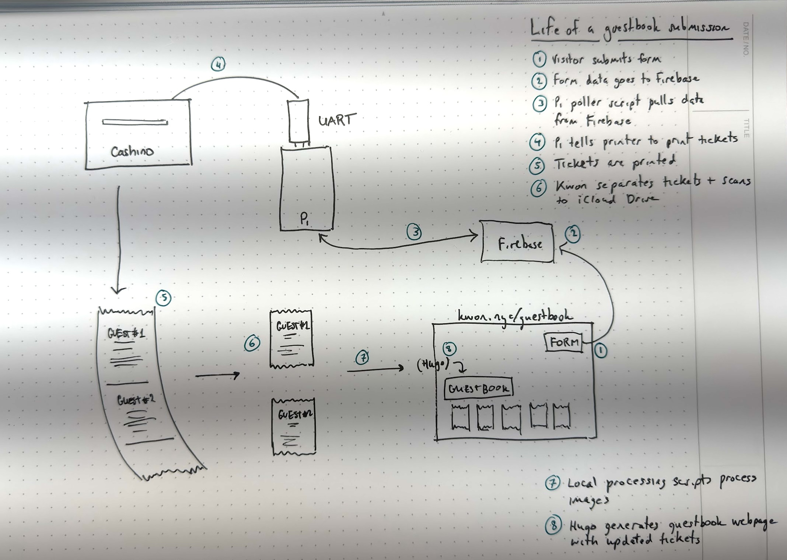

I made a [guestbook](/guestbook), just like we used to have in the old days
- had this thermal receipt printer that i got with an arduino uno years ago and never got around to 
- the green wire's connected to the ... green wire
- do things just for fun, even if they're slow and inefficient.
- submit a form on the internet --> have it manifest IRL --> post it back on the internet

Here are some other guestbooks by internet neighbors:
- https://bjhess.com/guestbook
- https://vhbelvadi.com/guestbook
- https://lr0.org/guestbook/
- https://burgeonlab.com/guestbook/
- https://zinzy.website/guestbook/

Other resources:
* https://simon-says.info/2014/2014-05-28-cashinotech-csn-a2-t-thermal-printer
* https://cdn-learn.adafruit.com/downloads/pdf/networked-thermal-printer-using-cups-and-raspberry-pi.pdf
* https://www.youtube.com/watch?v=r6KvQShmRJg
* https://github.com/exciting-io/printer/wiki/Making-your-own-printer-with-a-Raspberry-Pi
* https://developer.apple.com/documentation/vision/recognizing-text-in-images