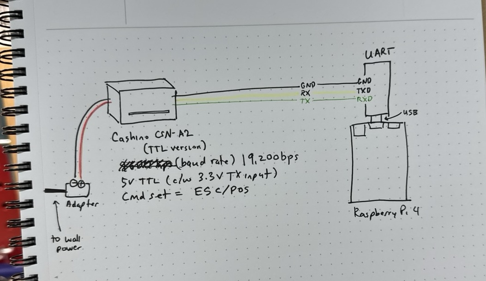
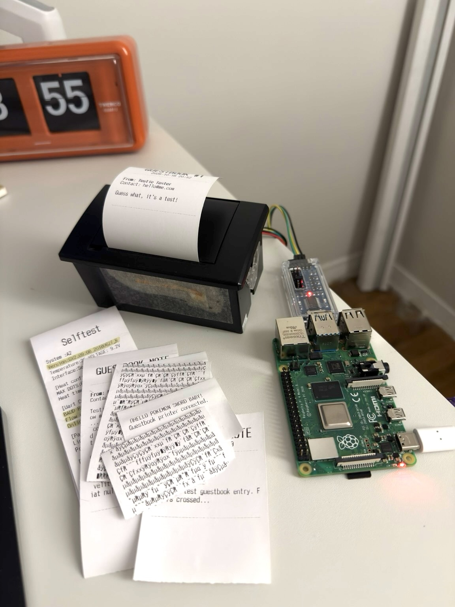

- made a guestbook like we used to have in the old days
- had this thermal receipt printer that i got with an arduino uno years ago and never got around to 
- the green wire's connected to the ... green wire
- do things just for fun, even if they're slow and inefficient.
- submit a form on the internet --> have it manifest IRL --> post it back on the internet

