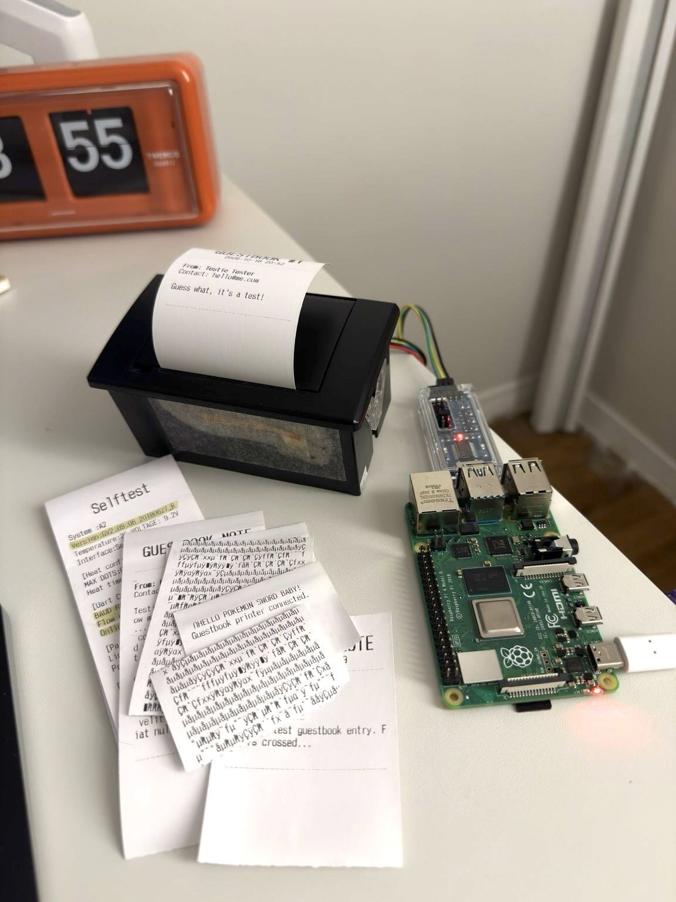
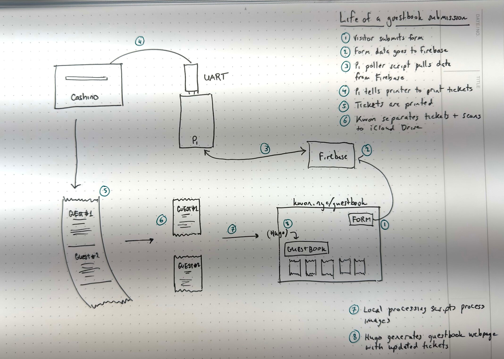

I made a [guestbook](/guestbook), like we used to have in the old days, except this one has a physical component. It's pretty inefficient and impractical, and I love it. My soul has been yearning to decouple the &lt;making of a Thing&gt; from &lt;being productive&gt; and to rediscover the joy of making things that are not really necessary but just fun. And, connected to the internet but with an IRL component. I got an old thermal receipt printer years ago (2019, according to the purchase confirmation email) that I was going to use for an Arduino project with the intention of doing something clever with it, but never did, until I felt a random spark of intrinsic motivation amongst the sea of external demands on my time and attention. Story of my life.

This project was kind of a nice meditation on connection and translating the virtual into the physical and back again. This is what it looks like right now:

There's nothing like having struggled with something that just wasn't working, and then the  euphoria of the moment where it just... works. I was intimidated by using breadboard wires, because they seemed so VISCERAL, and how I am supposed to know which wire goes where?

Well, you're not going to believe this, but the green wire connects to the—wait for it—other green wire (!). Who knew. 

Speaking of viscera, it kind of reminded me of doing kidney transplants where you have to hook up all the pipes correctly (anastomose vein to vein first, then artery to artery), release the floodgates (unclamp the vessels to perfuse blood to the new kidney) and cross your fingers (metaphorically speaking). If everything goes right, the new kidney turns a nice deep pinkish color and starts making urine within seconds (you literally see pee coming out of the open ureter) and then you know you can safely implant it into the bladder. 

Anyway, it's a very nice feeling when something you've been working on actually works and you can see and hear and feel it working whether it's a transplanted kidney that makes urine or a raspberry pi receipt printer that prints receipts.

I have gotten some very nice messages and was honestly very overwhelmed initially -- the internet is not really known for being a kind place for person to person connection these days, but seeing these messages print out one by one and reading them has been very uplifting. I received some messages from people who remembered my old blog from almost a quarter of a century ago when I was probably writing about my favorite tv shows and complaining about medical school (lol), and messages from newer internet neighbors through Mastodon and Bluesky, and emails from people ABOUT the actual guestbook, and it is all just very warm and fuzzy.

I did have two hiccups including a small set (I think 3-5) of lost tickets :( which was entirely my fault because in my state of pure unadulterated bliss of having gotten things working, I forgot that paper is a finite resource and the paper roll ran out in the middle of printing a batch and I had it set so that the submissions are deleted after being sent to the printer, and the printer is not smart enough to stop if it's out of paper, so they are lost forever. I am sad about that[^1] and if you had submitted a message on or around Oct 22-23 and didn't see it on the page, I'm sorry, and if you want, you should be able to try again now. In addition to obsessively checking the paper supply manually before printing now, I also have the data stored on the Pi for 7 days before deletion now. 

The other hiccup was spam (massive eyeroll) which necessitated some basic spam protections which are now in place (knock on wood).

Anywho this is roughly how it works (I apologize for the terrible quality image; apparently the frequency of the overhead fluorescent lighting conflicts with my phone camera leading to the zebra stripe effect, and I'm too lazy to re-do it):

Step by step showing which parts are in the physical world, virtual world, or both:

| Step | What                                                  | Physical | Virtual | Notes                                                                                                                                                                                                                                                                       |
| ---- | ----------------------------------------------------- | -------- | ------- | --------------------------------------------------------------------------------------------------------------------------------------------------------------------------------------------------------------------------------------------------------------------------- |
| 1    | Visitor submits form                                  | x        | x       | This was the last part I built even tho it's the first thing you see                                                                                                                                                                                                        |
| 2    | Form data goes to Firebase                            |          | x       | Spent a good bit of time noodling on the best way to handle the data. Ended up choosing Firebase but also considered a form-forwarder like Formspree that would send submissions as email that Pi could then access through IMAP.                                           |
| 3    | Pi poller script pulls data from Firebase             | x        | x       | Set this up to run automagically when the Pi is physically switched on                                                                                                                                                                                                      |
| 4    | Pi tells printer to print tickets                     | x        |         | (Also from the poller script)                                                                                                                                                                                                                                               |
| 5    | Tickets are printed                                   | x        |         | This is the fun part!                                                                                                                                                                                                                                                       |
| 6    | Kwon separates tickets and scans to iCloud Drive      | x        |         | Also fun. I have to hand rip the paper and get to read each one. I am not very familiar with iCloud Drive and find it cumbersome to work with but this seemed like the lowest barrier approach to get the physical tickets back into the virtual world on an ongoing basis. |
| 7    | Local processing scripts process images               |          | x       | Learned more about the Apple developer ecosystem here with Swift and Apple's version of OCR which is called "Vision". Also decided to obscure email addresses but show URLs.                                                                                                |
| 8    | Hugo generates guestbook webpage with updated tickets |          | x       | Standard Hugo templating here                                                                                                                                                                                                                                               |

I store the Pi + printer in my studio, so the submissions are queued up and get printed only when I'm physically there, which is usually a couple times a week. There's more detail on how it's wired up in the [README](https://github.com/rjkwon/blog/tree/main/scripts/guestbook) in my repo. 

I'm now working on building a small custom plywood box to house the setup, which I've also never done before and honestly isn't going very well. I'm coping badly. Literally -- I [tried using a coping saw](coping.jpg) for the first time and I [just](https://www.youtube.com/watch?v=2IRcM9qwDwo) -- 

Here are some other guestbooks by internet neighbors (if you have one you can email me the link and I'll sign it and add it here):
- https://burgeonlab.com/guestbook/
- https://zinzy.website/guestbook/
- https://jeddacp.me/guestbook/
- https://bjhess.com/guestbook
- https://vhbelvadi.com/guestbook
- https://lr0.org/guestbook/
- https://lunarloony.co.uk/guestbook/
- https://bluebottles.bearblog.dev/guestbook/
- https://www.yourworldoftext.com/~talyssa.txt/
- https://www.yourworldoftext.com/~skw

Other resources that were helpful in my journey:
* https://cdn-learn.adafruit.com/downloads/pdf/networked-thermal-printer-using-cups-and-raspberry-pi.pdf
* https://www.youtube.com/watch?v=r6KvQShmRJg
* https://simon-says.info/2014/2014-05-28-cashinotech-csn-a2-t-thermal-printer
* https://github.com/exciting-io/printer/wiki/Making-your-own-printer-with-a-Raspberry-Pi
* https://developer.apple.com/documentation/vision/recognizing-text-in-images

[^1]: it's sad but I got even sadder thinking about how those were real messages from real people that have been lost to the ether but meanwhile I buy one thing at a store with a credit card or have one meal at a restaurant via some reservation platform and for the rest of time I have to get emails or text messages from bots asking me to provide a rating and review of the thing or a reminder that I can get 10% off if I come back and spend more money at the establishment and so on and so forth... makes me so cranky. Sometimes I wanna just be like... guys. what are we doing. Like how there's a Whole Foods on the Gowanus Canal which is an EPA superfund site. There's something about buying organic vegetables and free range heirloom eggs from a store built next to a toxic dump (I'm not exaggerating... I can walk 10 steps from the "waterfront" into the store entrance) that makes me feel like we have really lost the plot.